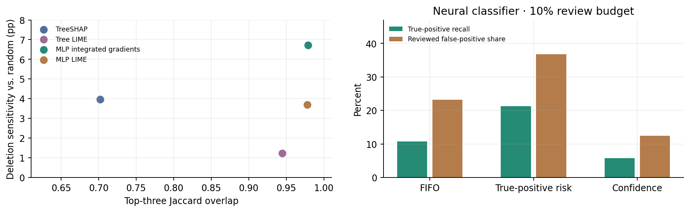
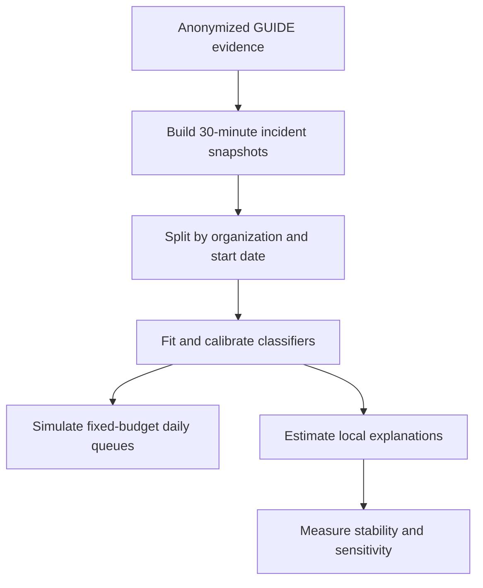
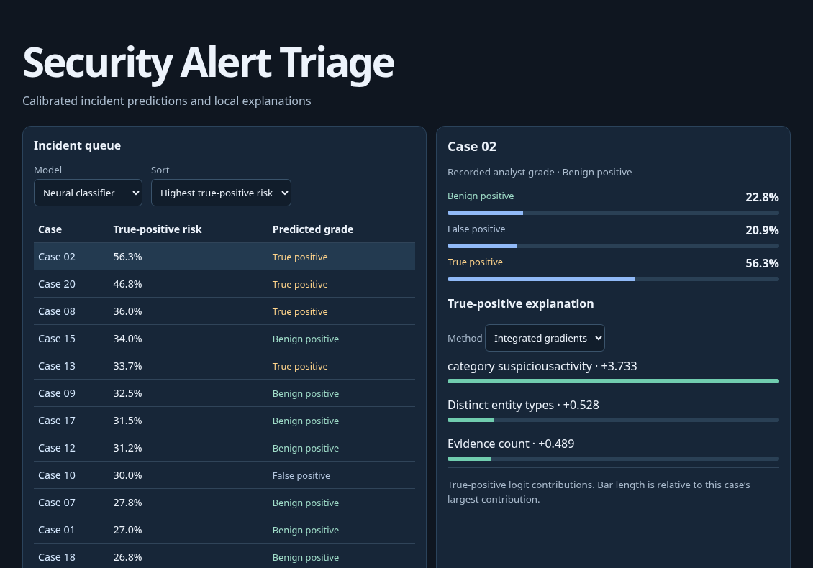

# Explainable Security Alert Classification

An incident-triage benchmark on analyst-graded Microsoft GUIDE evidence. It tests transfer to later dates and unseen organizations, compares four explanation configurations, and measures what a risk score changes in a fixed-budget review queue.

## Findings

The neural classifier reached **68.26% accuracy**, **0.545 macro-F1**, and **28.37% average precision for true positives** after calibration. At a daily 10% review budget, its risk ranking captured **21.29% of true positives** versus **10.71%** with FIFO. The reviewed false-positive fraction rose from **23.21% to 36.79%**. These are retrospective queue results. Analyst performance was outside the evaluation.

| Model | Accuracy | Macro-F1 | Calibrated true-positive AP |
|---|---:|---:|---:|
| Logistic regression | 57.27% | 0.388 | 22.00% |
| Gradient boosting | 61.35% | 0.387 | 24.03% |
| Neural classifier | 68.26% | 0.545 | 28.37% |

For gradient boosting, TreeSHAP's top-three median replacement changed true-positive probability **3.96 points more than random replacement**. LIME's change was **1.24 points**, but it had higher top-three overlap after perturbation (**0.944 vs. 0.702**). In the neural model, integrated gradients reached **0.979** overlap and **6.72 points** above random replacement. Replacement is a model sensitivity check. It can generate feature combinations outside the observed data.



## Design



- 8,051 test incidents from 486 held-out organizations. Validation and calibration have separate organizations and dates.
- Logistic regression, gradient boosting, and an MLP on the same allowlisted early measurements. The dedicated calibration cohort fits one temperature for each model.
- Evaluate TreeSHAP, LIME and integrated gradients over 180 sampled explanation cases. Resample 600 organization blocks for model AP uncertainty.
- The offline browser interface displays calibrated grades and local attributions for 24 anonymized test cases.

## Reproduce

```sh
python -m venv .venv
source .venv/bin/activate
python -m pip install torch==2.15.0 --index-url https://download.pytorch.org/whl/cpu
python -m pip install -e '.[report]'
OPENBLAS_NUM_THREADS=1 OMP_NUM_THREADS=1 python -m unittest discover -s tests -v
python -m alert_triage.data
OPENBLAS_NUM_THREADS=1 OMP_NUM_THREADS=1 python -m alert_triage.study
gzip -nc results/study.json > results/study.json.gz
python scripts/report.py
python -m alert_triage.dashboard
```

To view the included evidence, run `python -m alert_triage.dashboard` and open `results/alert-triage.html`. The browser interface is offline and uses the checked-in compressed results.



[Technical report](results/explainable-alert-triage-report.pdf) · [Methodology and citations](docs/METHODOLOGY.md) · [Résumé drafts and interview preparation](docs/INTERVIEW.md)

The source data remains subject to the Microsoft GUIDE data license. The benchmark uses early features from a privacy-transformed release. Organization and temporal shift are confounded. Calibration lowered log loss but increased top-label ECE for the neural model, highlighting metric and cohort sensitivity. Code development was AI-assisted.
